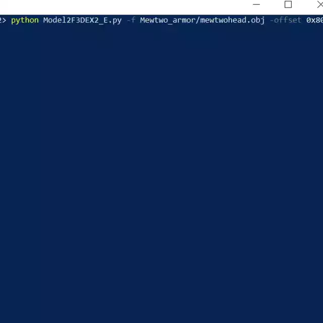
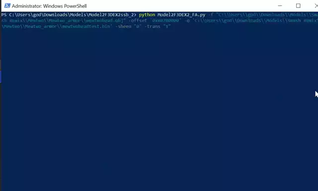

# Model2F3DEX2_Extension
Modifies F3DEX2 data to add extra features like environmental sheen, transparency, backface culling, etc.  
Also fixes problems with Model2F3DEX2 like vertice coloring, mesh linking, and blank FA commands while copying the output to the clipboard automatically.

This was used to help create [San Antonio Remix v2.0.1](https://github.com/OhThomas/smashremix/releases/tag/Latest)

## Usage
| Case | Example |
| :------- | :------- |
| Run Model2F3DEX2 (fixes FA commands, fixes vertice coloring, links meshes, and copies output to clipboard automatically): | `python Model2F3DEX2_E.py -file mewtwohead.obj -o mewtwohead.bin -offset 0x80700000`|
| Add costume palettes: | `python Model2F3DEX2_E.py -file mewtwohead.obj -o mewtwohead.bin -offset 0x80700000 -costume DE0000000E000000`|
| Add environmental sheen: | `python Model2F3DEX2_E.py -file mewtwohead.obj -o mewtwohead.bin -offset 0x80700000 -sheen all`|
| Add transparency: | `python Model2F3DEX2_E.py -file mewtwohead.obj -o mewtwohead.bin -offset 0x80700000 -trans all`|
| Add backface culling: | `python Model2F3DEX2_E.py -file mewtwohead.obj -o mewtwohead.bin -offset 0x80700000 -backface_culling all`|
| Add effects to specific parts (seperated by mesh grouping): | `python Model2F3DEX2_E.py -file mewtwotorso.obj -o mewtwotorso.bin -offset 0x80700000 -backface_culling 1,2 -sheen 0,1,3 -trans 4`|

### Example
<figure>
     paste into RAM -> direct pointers">
    <figcaption> This shows me running the program, pasting the output into RAM space for Smash Remix at 0x80700000, and then using a F3DEX2 jump command from Mewtwo's head to 0x80700E40 (first display list from output that I highlight) to show the new converted model I just pasted. </figcaption>
</figure>

## Arguments
| Argument | Description |
| :------- | :------- |
| -file | OBJ file we're converting to F3DEX2.|
| -offset | Hexadecimal location of where we're adding the file in the RAM space, ex: '0x80700000'.|
| -model2f3dex_path | Path location of Model2F3DEX2.exe (include exe).|
| -costume | Changes FD1 commands based on costume palette, ex: 'DE0000000E000000' (currently applies to all mesh parts).|
| -backface_culling | Adds backface culling to specific mesh parts in the OBJ file, enter 'all' or '0,2,3' depending on mesh part order.|
| -sheen | Adds environmental sheen to specific mesh parts in the OBJ file, enter 'all' or '0,2,3' depending on mesh part order.|
| -transparency | Adds transparency to specific mesh parts in the OBJ file by replacing first palette with 0000, enter 'all' or '0,2,3' depending on mesh part order.|
| -sheen_command | Commands to replace sheen with, will either replace these commands if they're already in the mesh part or add them, ex: 'D9FFFFFF00040001,F54004000001066C,D700000207FF07FF' (comma seperated).|
| -trans_command | Commands to replace transparency with, will either replace these commands if they're already in the mesh part or add them, ex: 'E300100100008000,FCFFFFFFFFFCF279,E200001C00507078' (comma seperated).|
| -no_mtl | Prevents changing Ka/Kd commands in MTL file (Ka blocks Kd command for Model2F3DEX2 which is needed for primitive coloring).|
| -debug | Prints debugging messages to output.|
| -no_copy | Prevents copying output to clipboard.|
| -output | Output file.|

## Requirements

 - [Model2F3DEX-SSB](http://n64vault.com/ssb-tools:model2f3dex-ssb) (developed specifically for SSB version; may or may not work with other converters)

## License
Copyright (C) 2025 Thomas Rader

